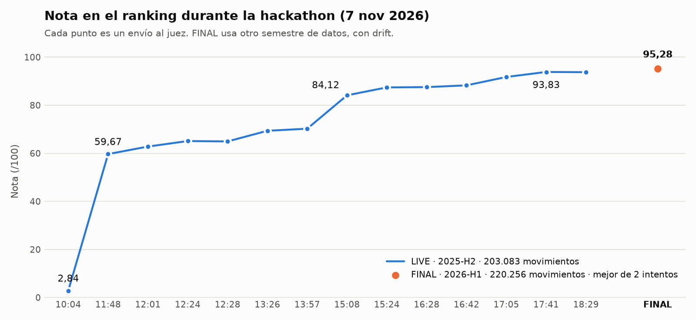
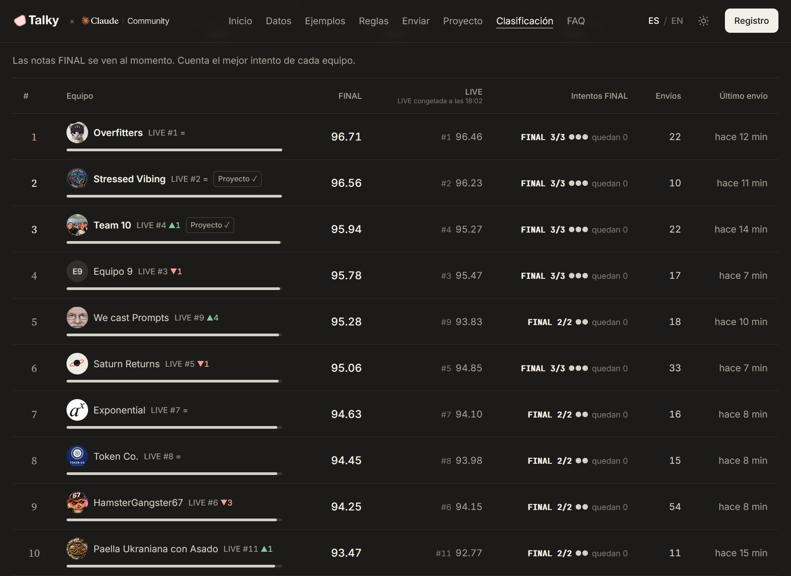
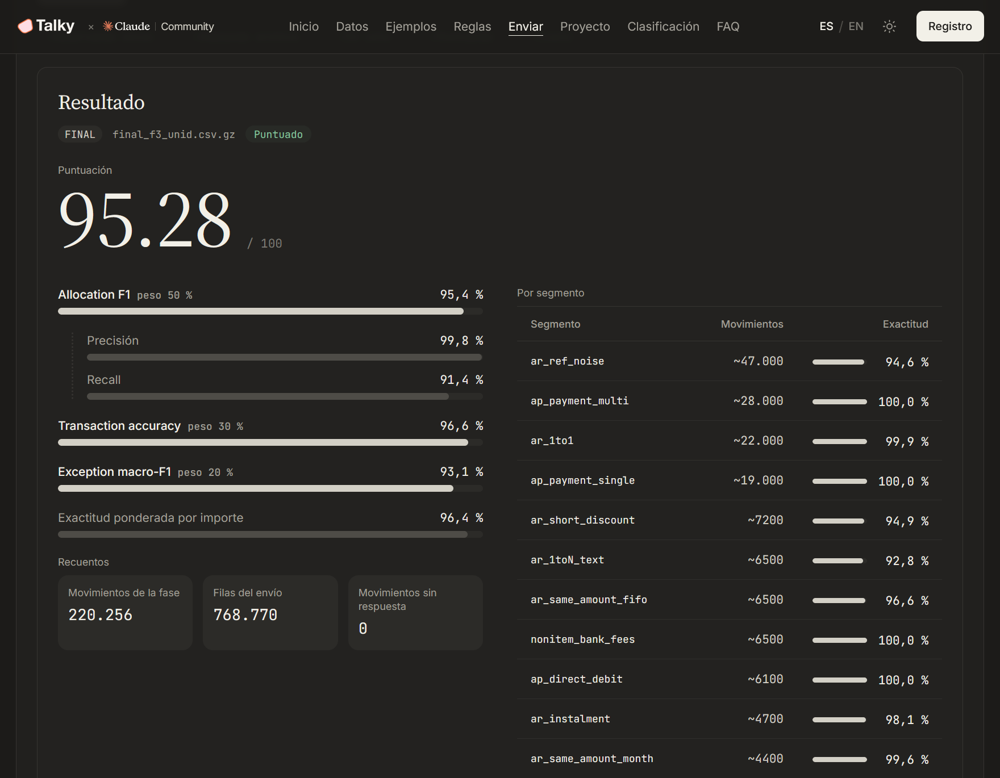
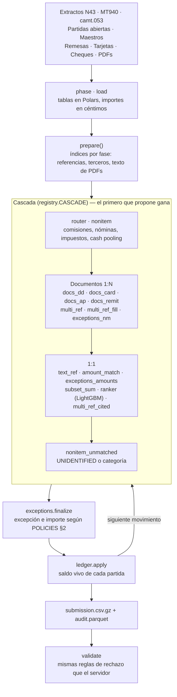

# Close The Books - Conciliación bancaria a escala

**Motor de conciliación bancaria en Python que decide, para cada movimiento del banco, qué facturas y abonos abiertos liquida y por qué importe. Hecho en la Claude Code Hackathon de Talky.**

[](https://github.com/xilin01/Hackathon-Close-The-Books/actions/workflows/tests.yml)
[](LICENSE)


<p align="center">
  <picture>
    <source media="(prefers-color-scheme: dark)" srcset="docs/img/progresion-nota-dark.png">
    
  </picture>
</p>

---

## Resultado

- **5to puesto de Madrid y 1er equipo de la UCM** de +15 equipos participantes.
- **95,28 / 100 en FINAL**, sobre 220.256 movimientos de un semestre nunca visto y con *drift* a propósito.
- **Del 9.º puesto en LIVE al 5.º en FINAL**: la nota subió al cambiar de datos (93,83 → 95,28), señal de que el sistema generaliza.
- De **2,84 a 93,83** en el ranking LIVE durante el día.

<p align="center">
  
</p>

| Métrica del juez | Peso | FINAL |
| --- | --: | --: |
| Allocation F1 (pares movimiento–partida con importe correcto) | 50 % | **95,4 %** (precisión 99,8 % · recall 91,4 %) |
| Transaction accuracy (todas las filas del movimiento bien) | 30 % | **96,6 %** |
| Exception macro-F1 (10 clases, raras y comunes pesan igual) | 20 % | **93,1 %** |

<p align="center">
  
</p>

El histórico de envíos, con la nota por segmento, está en [`docs/SCOREBOARD.md`](docs/SCOREBOARD.md). Recoge los 14 envíos de LIVE y el primer intento de FINAL (93,86). El segundo intento (95,28) es el que cuenta en la clasificación.

---

## El reto

El **Grupo Valtermia** (ficticio, todos los datos son sintéticos) tiene 17 sociedades en 15 países, 12 divisas, 13 bancos y 47 cuentas. Su tesorería recibe cientos de miles de movimientos bancarios por semestre. Para cada uno hay que decir:

1. Qué **partidas abiertas** liquida (facturas y abonos de clientes y proveedores) y **por qué importe**.
2. Si no liquida ninguna, qué es (**categoría**: comisión, nómina, impuesto, *cash pooling*…).
3. Qué **excepción** tiene de una lista cerrada: pago parcial, pronto pago, gastos bancarios, retención, diferencia de cambio, devolución, duplicado, cobro no identificado…

Los datos llegan como los recibiría una empresa real:

- Extractos en **Norma 43**, **MT940** y **camt.053** (XML).
- Remesas de recibos, liquidaciones de tarjeta, ingresos de cheques, *confirming* y *payment runs*.
- **Avisos de pago en PDF**.

El texto del banco no trae el identificador de la factura. Solo trae el número impreso, a menudo sin prefijo, con erratas o cortado a 16, 35 o 38 caracteres.

| Fase | Periodo | Qué hay |
| --- | --- | --- |
| TRAIN | 2021-07 → 2025-06 | Datos y etiquetas (4 años) |
| LIVE | 2025-07 → 2025-12 | Ranking en vivo durante el día |
| FINAL | 2026-01 → 2026-06 | Datos a las 18:00, **muy pocos intentos puntuados** (cuenta el mejor), cierre a las 19:30 |

FINAL trae *drift*: una filial nueva en Sudáfrica (ZAR), un banco que migra de Norma 43 a camt.053, clientes renombrados y una cuenta de cobros nueva.

**Nota** = 100 × (0,5 · Allocation F1 + 0,3 · Transaction accuracy + 0,2 · Exception macro-F1).

El enunciado completo está en [`bankrec-docs-and-masters/`](bankrec-docs-and-masters/README.md) (`POLICIES.md`, `FORMAT.md`, `DATA_DICTIONARY.md`).

---

## Cómo funciona

Una **cascada de resolvers** recorre los movimientos en orden de fecha. El primer resolver que propone una asignación gana. Los más precisos van primero, los más arriesgados, al final. Un **ledger** de partidas abiertas mantiene el saldo vivo de cada factura, así que un pago parcial de hoy cambia lo que se puede asignar mañana.



Cada resolver cumple un contrato pequeño (`bankrec/contract.py`):

```python
Alloc(item_id: str, amount_cents: int, exception: str = "")
Proposal(bank_txn_id, allocs: list[Alloc], category="", exception="", confidence=0.0, resolver="", reason="")
```

Y define `prepare(ctx)` más `resolve_batch(ctx)` (joins vectorizados) o `resolve(txn, ctx, ledger)` (movimiento a movimiento, con el ledger).

### Decisiones de diseño

| Decisión | Por qué |
| --- | --- |
| **Precisión antes que recall** | Un par mal asignado resta en precisión y además rompe el movimiento entero en *transaction accuracy*. Ante la duda, el resolver se abstiene y pasa al siguiente. Resultado: 99,8 % de precisión en FINAL. |
| **Importes en céntimos `int`** | Nunca se suman ni comparan floats. La tolerancia del juez (máx. 0,01 o 0,5 %) se aplica sobre enteros. |
| **Ningún resolver tumba la ejecución** | Cada llamada va en `try/except`. Si un resolver falla, se registra y la cascada sigue. Nunca falta un movimiento en la salida. |
| **Anti-overfitting explícito** | Ningún resolver lee etiquetas. Los modelos solo entrenan con datos anteriores a la fase. Umbrales redondos, reglas apoyadas en `POLICIES.md` o en patrones de varios años, y backtests en 2024-H1 y 2025-H1. LIVE confirma, no se optimiza contra él. |
| **Reproducible al byte** | `PYTHONHASHSEED=0`, órdenes estables y gzip con `mtime=0`. Dos portátiles con el mismo commit dan el mismo SHA-256, así que el envío FINAL se puede contrastar con un portátil de respaldo. |
| **Ranker LightGBM solo para lo ambiguo** | Las reglas resuelven los casos con evidencia clara. El modelo solo desempata candidatas 1:1, con *holdout* temporal y *features* invariantes a la escala del importe. |

---

## Trabajo en equipo con Claude Code

Cuatro personas, cada una con su Claude Code, trabajando a la vez sobre el mismo repo durante un día. La coordinación vive en el propio repositorio:

- **[`CLAUDE.md`](CLAUDE.md)** es el contrato del equipo: el reto en un minuto, la **propiedad de cada fichero por rol** (cada uno toca solo lo suyo), el contrato de los resolvers, las reglas anti-overfitting y la guía paso a paso del envío FINAL.
- **Skill `eval`** ([`.claude/skills/eval`](.claude/skills/eval/SKILL.md)): cómo medir cualquier cambio (smoke, validación por segmento, volcado de fallos).
- **Agente `golden-auditor`** ([`.claude/agents`](.claude/agents/golden-auditor.md)): auditor de solo lectura que agrupa los fallos de un segmento en patrones con ejemplos.
- **[`docs/SCOREBOARD.md`](docs/SCOREBOARD.md)**: cada envío con su commit, su nota de validación local y su nota en LIVE. Regla: un cambio por envío.

---

## Estructura

```
bankrec/
├── contract.py · registry.py · pipeline.py · pipeline_post.py   Contrato, orden de la cascada y ejecución
├── phase.py · load.py · ledger.py · config.py                    Fases, carga con caché y saldo vivo
├── refs.py · parties.py                                          Números impresos y terceros (fuzzy)
├── pdf_text.py · pdf_facts.py                                    Texto y hechos de los avisos en PDF
├── exceptions*.py                                                Excepciones e importes (POLICIES §2)
├── validate.py                                                   Validador con las reglas del servidor
└── resolvers/                                                    Resolvers de la cascada y sus helpers
scripts/   run_phase.py · eval.py · smoke.py · backtest.py · submit.py · análisis offline (p3_*, p4_*)
tests/     Regresiones sintéticas (matching, avisos de pago, categorías y envíos)
docs/      SCOREBOARD, notas de datos, plan de mejoras y generalización
bankrec-docs-and-masters/   Enunciado, maestros, un mes de muestra y evaluador oficial
```

---

## Cómo ejecutarlo

**Requisitos:** Python 3.12 y [uv](https://docs.astral.sh/uv/).

```bash
git clone https://github.com/xilin01/Hackathon-Close-The-Books.git
cd Hackathon-Close-The-Books
uv sync
```

**Sin descargar nada más** (usa el mes de muestra incluido en el repo):

```bash
uv run python scripts/smoke.py                                   # pipeline + validador + evaluador oficial, ~30 s
uv run python -m unittest discover -s tests -p '*test*.py'       # tests de regresión
```

`smoke.py` termina en `SMOKE VERDE` y muestra la nota sobre la muestra. Sin los datos de TRAIN, el ranker se desactiva y lo avisa en el log.

**Con los datos completos del reto** (TRAIN, LIVE y FINAL los repartía la organización): crea `bankrec.local.toml` con la carpeta que contiene `train/`, `live/` y `final/`:

```toml
data_dir = "C:/Users/<yo>/CTB"
```

(o usa la variable de entorno `BANKREC_DATA`) y ejecuta:

```bash
uv run python scripts/run_phase.py --phase val                   # TRAIN 2025-H1 como validación local
uv run python scripts/eval.py --phase val                        # nota, métricas y fallos por segmento
uv run python scripts/run_phase.py --phase live                  # out/live/submission.csv.gz, ya validado
```

LIVE completo (203.083 movimientos) tarda menos de 10 minutos en un portátil.

---

## Mi contribución

**P1 (core)**: 60 de los 130 commits.

- **Arquitectura:** esqueleto del proyecto, contrato de resolvers, carga con caché, fases, ledger, pipeline, cascada y validador.
- **Matching 1:1:** referencias impresas (`refs`), identificación de terceros (`parties`), `text_ref`, `amount_match` (incluido FX y `DUPLICATE_PAYMENT`) y el ranker LightGBM.
- **Matching 1:N:** `multi_ref_fill` y `multi_ref_cited` para conceptos cortados, y la suma exacta de `pipeline_post`.
- **Proceso:** `CLAUDE.md`, reglas anti-overfitting, reproducibilidad al byte y la guía paso a paso del envío FINAL.

---

## Equipo — *We cast Prompts*

| Rol | Persona | Ámbito |
| --- | --- | --- |
| P1 · core | **Xiang Lin** ([@xilin01](https://github.com/xilin01)) | Arquitectura, matching 1:1, ranker, envío FINAL |
| P2 · documentos | Feiyang Mao ([@TamuraA12](https://github.com/TamuraA12)) | Remesas, tarjetas, cheques, avisos de pago, *payment runs*, subset-sum |
| P3 · PDFs y excepciones | Cristina Zhang ([@ShImM0](https://github.com/ShImM0)) | Texto de PDFs, excepciones e importes, casos N:M |
| P4 · QA y envíos | Daniel Manjón ([@DanielManjon126](https://github.com/DanielManjon126)) | Categorías sin partida, validador, tests, envíos y scoreboard |

Repositorio original del equipo: [ShImM0/hackCloseTheBooks](https://github.com/ShImM0/hackCloseTheBooks). Este repo conserva su historial.

---

## Licencia

El código se distribuye bajo la licencia **MIT**: consulta [`LICENSE`](LICENSE).

El material del reto en [`bankrec-docs-and-masters/`](bankrec-docs-and-masters/) (enunciado, maestros, muestra y evaluador) es de la organización de la hackathon y no está cubierto por esa licencia. Todos sus datos son sintéticos.
